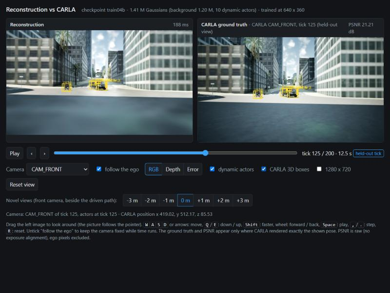

# carla-nurec

Synthetic driving data from CARLA on a MirrorMile world (Downtown LA, `LA_DTLA_ODR`), recorded from the ego in a
multi-actor scenario, converted to NVIDIA NuRec's input format (NCore V4), reconstructed as 3D Gaussians with the
static background and the dynamic actors separated the way NuRec does it, and compared with CARLA's ground truth.


**Read first:** [docs/report.md](docs/report.md) (summary, numbers, limitations) - [docs/results.md](docs/results.md)
(all tables and pictures) - [docs/scenario.md](docs/scenario.md) - [docs/formats.md](docs/formats.md) -
[docs/notes.md](docs/notes.md) (research: NuRec, 3DGRUT / 3DGUT, feed-forward models; CARLA build findings) -
[cloud/README.md](cloud/README.md) (running real NuRec on a Linux GPU machine).

| held-out on-path views | novel views +-1 / +-2 / +-3 m | depth AbsRel | lidar F-score @ 0.5 m | fit on RTX 4050 6 GB |
|---|---|---|---|---|
| 21.5 dB / SSIM 0.852 / LPIPS 0.230 | ~20.8 / ~19.6 / ~18.6 dB | 0.065 | 0.83 | 54 min, 1.95 GB VRAM |

## Layout

```
scenario/plan.py          scenario plan from the OpenDRIVE (paths, speed profiles, clearance check) -> plan.json
scenario/plot_plan.py     top-down picture of the plan
scenario/record.py        CARLA run: 6 cameras (RGB / depth / instance), lidar, actor boxes, recorder;
                          --novel: re-simulation with offset cameras for novel-view ground truth
scenario/rider_ik.py      inverse kinematics of the cyclist's rider pose (rider_pose.json); rider_pose.py renders it
scenario/rig.json         camera / lidar rig
convert/                  measured CARLA conventions, instance-id map, raw -> PNG, dataset, NCore V4 export
recon/model.py, train.py  composite 3DGUT model (gsplat): background + per-actor Gaussians + sky, trainer
evaluate/                 evaluation, exposure check, report generator, actor debug renders
viewer/                   interactive viewer: the reconstruction rendered live next to CARLA's ground truth
replay/                   3D replay viewer (three.js + Gaussian splats): scene, actors, map, lidar, cameras over time
cloud/                    NuRec run script + notes for a Linux GPU machine (not run here)
run_carla.ps1             CARLA server (-game, off-screen) -> client jobs -> server stopped (also on failure)
run_pipeline.ps1          everything after planning
```

## Running

Requirements: CARLA 0.10 UE5 source build with the `LA_DTLA_ODR` map; the CARLA Python client in a Python 3.8 venv
(`CARLA_PY38`, default `C:\mywork\osm2carla\venv38`); `.venv` (Python 3.10) with torch 2.4.0+cu124, gsplat
1.5.3+pt24cu124 (Windows wheel), numpy 1.26.4, scipy, pillow, lpips, nvidia-ncore.

```powershell
& C:\mywork\osm2carla\venv38\Scripts\python.exe scenario\plan.py C:\mywork\osm2carla\build\nurec\plan.json
.\run_pipeline.ps1 -Build C:\mywork\osm2carla\build\nurec -Tag 04
```

Outputs (recordings, datasets, NCore, checkpoints, evaluation) go to `-Build`, outside the repository.

## Viewer

```powershell
.\.venv\Scripts\python.exe viewer\serve.py C:\mywork\osm2carla\build\nurec\ds04 C:\mywork\osm2carla\build\nurec\train04b\ckpt.pt --novel C:\mywork\osm2carla\build\nurec\novel04
```

Then open http://127.0.0.1:8765/. A local server renders the checkpoint on the GPU (about 30 ms per 640 x 360 or
1280 x 720 frame on the RTX 4050) for any of the six rig cameras at any tick, moved and turned freely from there
(drag, W A S D, Q / E). It shows RGB, depth or the error image, with the dynamic actors switched on or off, and
CARLA's 3D boxes as an overlay. Where CARLA rendered exactly the shown pose, the ground truth is shown beside the
reconstruction with its raw PSNR at the shown resolution: the rig cameras at every tick, and the front camera at
-3 ... +3 m beside the path every 4th tick.



## 3D replay viewer

The scenario replayed in 3D, laid out like the viewer for NVIDIA's sample NuRec clip: the drive's static lidar points
coloured from the cameras as the scene, the ego and actor boxes with trails, the OpenDRIVE lane lines / road edges /
crosswalks, the semantic lidar sweep of the current tick, and a camera panel with CARLA's image and the
reconstruction's render of the selected camera (PSNR, training or held-out view). Views: chase, top-down, free orbit,
and through any rig camera (front camera up to +-3 m to the side, where the panel shows CARLA's re-simulated image).
"Splats (approx.)" draws the reconstruction's Gaussians in the browser (background plus every dynamic actor moving
with its box) with standard splatting, which does not reproduce this 3DGUT model: through the front camera it
matches the model's own renders at only 7-9 dB (gsplat's standard splatting in Python: 14.6-16.3 dB), so it is off by
default and only a rough preview.

```powershell
& C:\mywork\osm2carla\venv38\Scripts\python.exe replay\map_layers.py C:\mywork\osm2carla\export\LA_DTLA\LA_DTLA.xodr C:\mywork\osm2carla\build\nurec\replay04\map_layers.json --center 410.78,523.77
$b = "C:\mywork\osm2carla\build\nurec"
.\.venv\Scripts\python.exe replay\build_replay.py $b\ds04 $b\train04b\ckpt.pt $b\eval04b $b\replay04\map_layers.json $b\replay04 --novel $b\novel04
.\.venv\Scripts\python.exe replay\serve.py $b\replay04
```

Then open http://127.0.0.1:8792/. The browser loads three.js 0.160.0 and GaussianSplats3D 0.4.7 from
cdn.jsdelivr.net. In the splat export, background Gaussians beyond 2200 m from the centre (outside the model's
2000 m far plane from every camera) are left out.

## License

The code is licensed under the Apache License 2.0 (see [LICENSE](LICENSE)).

- The images in `docs/img` are renders of CARLA scenes: CARLA's assets (vehicles, walkers, props, sky) are CC-BY 4.0
  (attribution: "CARLA"), CARLA's code is MIT.
- The world is MirrorMile's Downtown Los Angeles map. Map data (c) OpenStreetMap contributors (ODbL 1.0); elevation and
  lidar: USGS 3DEP; imagery: USDA NAIP.
- `replay/index.html` loads three.js and GaussianSplats3D (both MIT) from cdn.jsdelivr.net at run time; they are not
  part of this repository.
