## Reconstruction

| | |
|---|---|
| training resolution | 640 x 360 |
| iterations | 30000 |
| wall time | 47.6 min |
| peak VRAM (torch allocated) | 1959 MB |
| Gaussians (background / actors) | 1200000 / 210000 |

## Held-out on-path views (every 10-th tick, all cameras; 120 images)

| camera | PSNR dB | SSIM | LPIPS (alex) |
|---|---|---|---|
| CAM_FRONT | 21.78 | 0.900 | 0.153 |
| CAM_FRONT_LEFT | 23.73 | 0.901 | 0.159 |
| CAM_FRONT_RIGHT | 22.39 | 0.876 | 0.169 |
| CAM_BACK_LEFT | 23.79 | 0.900 | 0.160 |
| CAM_BACK_RIGHT | 21.60 | 0.864 | 0.196 |
| CAM_BACK | 21.39 | 0.855 | 0.177 |
| **all, raw** | **22.45** | **0.883** | **0.169** |
| all, exposure-aligned | 23.38 | 0.888 | 0.166 |

Raw: the rendering as is. Exposure-aligned: a per-image affine colour fit between rendering and ground truth first (CARLA's automatic exposure differs per image; the model never saw these images' exposure).

Depth vs CARLA depth (non-sky, < 80 m, alpha > 0.5): AbsRel 0.059, RMSE 5.13 m, median |error| 0.241 m, delta<1.25 0.971.

## Novel views off the driven path (front camera shifted sideways, CARLA re-simulation)

| lateral offset (+ = right) | views | PSNR dB | SSIM | LPIPS | PSNR / SSIM / LPIPS exposure-aligned | depth AbsRel | depth median abs m |
|---|---|---|---|---|---|---|---|
| -3 m | 49 | 19.11 | 0.834 | 0.210 | 20.00 / 0.836 / 0.210 | 0.078 | 0.374 |
| -2 m | 51 | 20.21 | 0.855 | 0.189 | 21.29 / 0.863 / 0.185 | 0.076 | 0.340 |
| -1 m | 51 | 21.51 | 0.876 | 0.165 | 23.11 / 0.890 / 0.159 | 0.066 | 0.315 |
| +0 m | 51 | 22.56 | 0.891 | 0.151 | 24.69 / 0.907 / 0.144 | 0.062 | 0.300 |
| +1 m | 51 | 21.53 | 0.876 | 0.161 | 23.27 / 0.892 / 0.156 | 0.063 | 0.308 |
| +2 m | 51 | 20.17 | 0.857 | 0.179 | 21.46 / 0.870 / 0.174 | 0.067 | 0.333 |
| +3 m | 51 | 19.11 | 0.837 | 0.198 | 20.09 / 0.846 / 0.196 | 0.070 | 0.358 |

Re-simulation noise floor (re-simulated front camera at offset 0, ego parked out of view, vs the live recording, ego pixels excluded; differences come from walker animation, the missing ego shadow and exposure): PSNR 31.80 dB, SSIM 0.974, LPIPS 0.014 over 51 frames. Re-simulated actor positions vs the live run (mean / max m): lead 0.000/0.000, cyclist 0.000/0.000, oncoming_lt 0.000/0.000, oncoming_rt 0.000/0.000, oncoming_stop 0.000/0.000, ped_far_0 0.000/0.000, ped_far_1 0.000/0.000, ped_left_0 0.000/0.000, ped_left_1 0.000/0.000, ped_right_0 0.000/0.000, wait_0 0.000/0.000, wait_1 0.000/0.000, cyclist_rider 0.000/0.000.

Skipped 2 novel views whose camera was inside an actor box: frame 172 -3 m (oncoming_stop), frame 176 -3 m (oncoming_stop).

## Geometry vs lidar (held-out ticks, within 50 m)

| | |
|---|---|
| rendered depth at lidar points: median abs error | 0.196 m |
| ... within 0.5 m / 1 m | 0.801 / 0.915 |
| chamfer: accuracy (recon -> lidar) mean / median | 0.759 / 0.178 m |
| chamfer: completeness (lidar -> recon) mean / median | 0.052 / 0.037 m |
| F-score @ 0.2 m / 0.5 m | 0.696 / 0.886 |

## Dynamic actors

| actor | mask IoU (views) | Gaussian extent l x w x h (m) | ground-truth box (m) | centre offset (m) |
|---|---|---|---|---|
| cyclist | 0.782 (7) | 0.83 x 0.61 x 1.39 | 1.47 x 0.84 x 1.48 | 0.198 |
| lead | 0.774 (9) | 2.50 x 1.83 x 1.26 | 4.18 x 1.99 x 1.39 | 0.927 |
| oncoming_lt | 0.795 (14) | 5.30 x 2.14 x 1.91 | 5.59 x 2.15 x 2.06 | 0.029 |
| oncoming_rt | 0.768 (13) | 5.04 x 1.76 x 1.28 | 5.36 x 2.03 x 1.41 | 0.081 |
| oncoming_stop | 0.668 (11) | 5.14 x 1.63 x 1.36 | 5.35 x 1.79 x 1.57 | 0.107 |
| ped_far_0 | 0.564 (8) | 0.93 x 0.48 x 1.71 | 0.33 x 0.87 x 1.80 | 0.294 |
| ped_far_1 | 0.569 (5) | 0.76 x 0.48 x 1.76 | 0.40 x 0.70 x 1.93 | 0.179 |
| ped_left_0 | 0.000 (2) | 126.62 x 23.26 x 14.46 | 0.37 x 0.72 x 1.83 | 62.006 |
| ped_left_1 | 0.010 (1) | 22.17 x 13.87 x 17.43 | 0.42 x 0.78 x 1.95 | 15.365 |
| ped_right_0 | - | 0.27 x 0.49 x 1.52 | 0.43 x 0.70 x 1.84 | 0.141 |

actor positions come from the ground-truth boxes (as NuRec's cuboid tracks); IoU measures how well the reconstructed actor shape covers CARLA's instance mask, with occlusion

CARLA recorder replay (not used for ground truth): best alignment replay tick = frame + 32 (lead max error 1.7949 m); replayed actor position error vs the live run (mean / max m): ego 0.73/1.80, lead 0.90/1.79, oncoming_lt 0.67/1.48, oncoming_rt 0.62/1.38, oncoming_stop 0.47/1.61, ped_far_0 0.01/0.01, ped_far_1 0.01/0.01, ped_left_0 0.01/0.01, ped_left_1 0.01/0.01, ped_right_0 0.01/0.21, wait_0 0.00/0.02, wait_1 0.00/0.04, cyclist_rider 0.50/1.00.

## Exposure check

Median brightness ratio of the same static surfaces in two images (1.00 = same exposure): neighbour same tick 1.121 (5-95 %: 0.990-1.253, 66 pairs); same cam 5 ticks 1.001 (5-95 %: 0.870-1.263, 60 pairs); same cam 20 ticks 1.046 (5-95 %: 0.729-1.580, 60 pairs).

## Pictures

**novel_0040_off+1** (top: CARLA | reconstruction; bottom: |error| x4 | rendered depth)

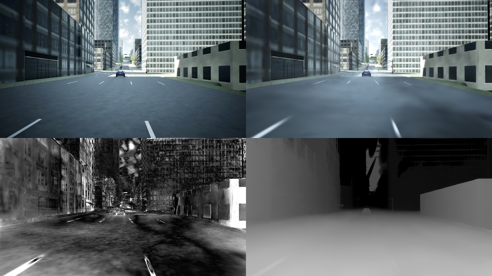

**novel_0040_off+3** (top: CARLA | reconstruction; bottom: |error| x4 | rendered depth)

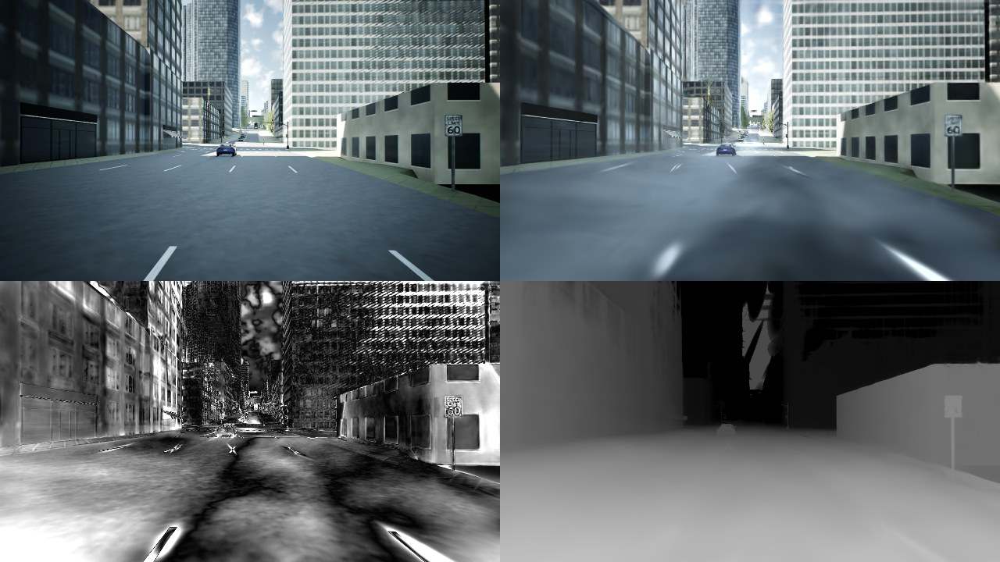

**novel_0040_off-1** (top: CARLA | reconstruction; bottom: |error| x4 | rendered depth)

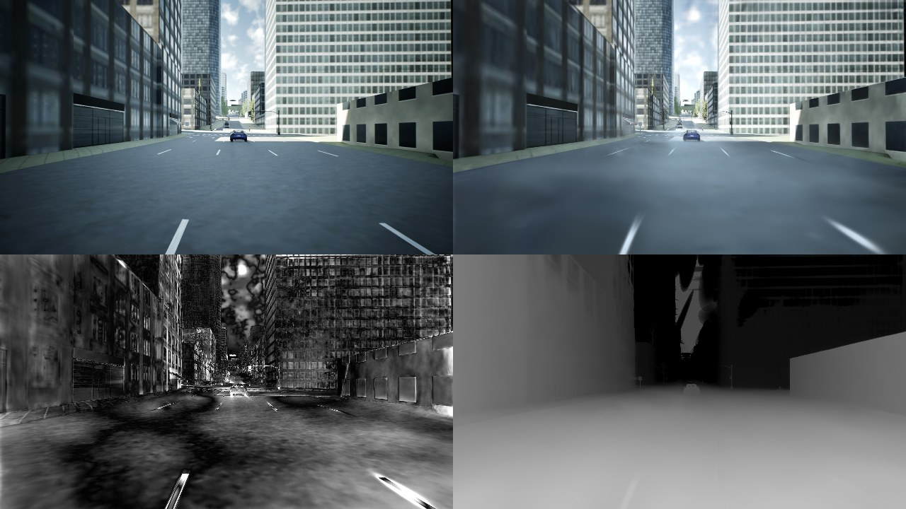

**novel_0040_off-3** (top: CARLA | reconstruction; bottom: |error| x4 | rendered depth)

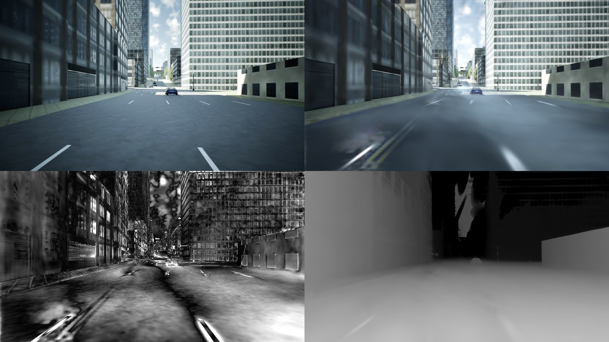

**novel_0100_off+1** (top: CARLA | reconstruction; bottom: |error| x4 | rendered depth)

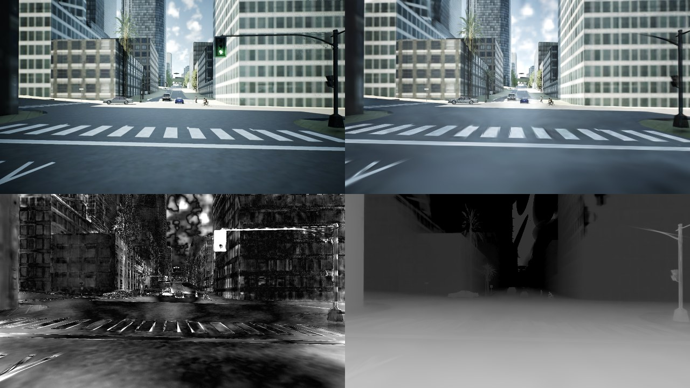

**novel_0100_off+3** (top: CARLA | reconstruction; bottom: |error| x4 | rendered depth)

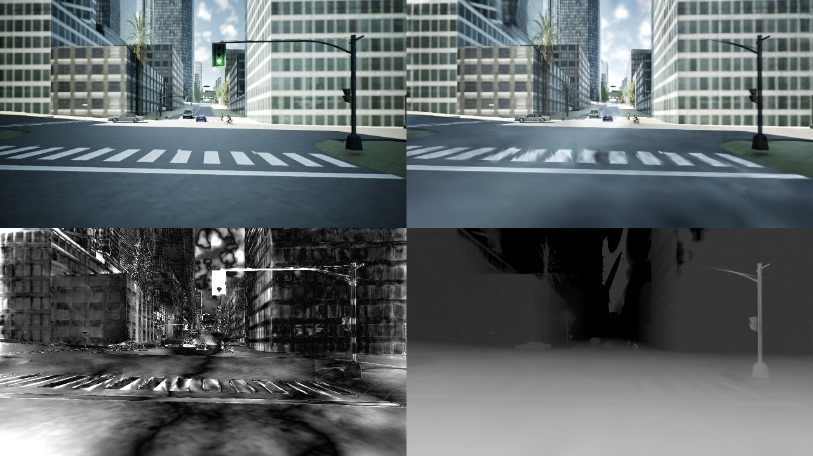

**novel_0100_off-1** (top: CARLA | reconstruction; bottom: |error| x4 | rendered depth)

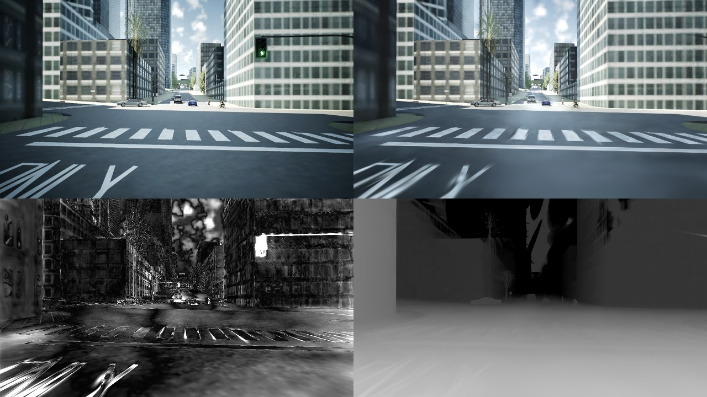

**novel_0100_off-3** (top: CARLA | reconstruction; bottom: |error| x4 | rendered depth)

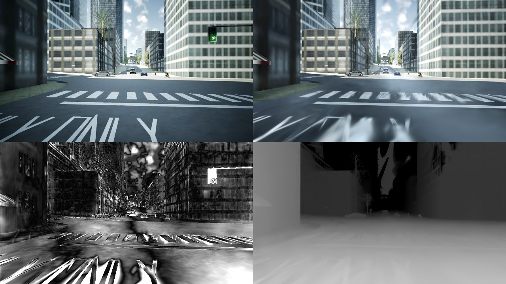

**novel_0160_off+1** (top: CARLA | reconstruction; bottom: |error| x4 | rendered depth)

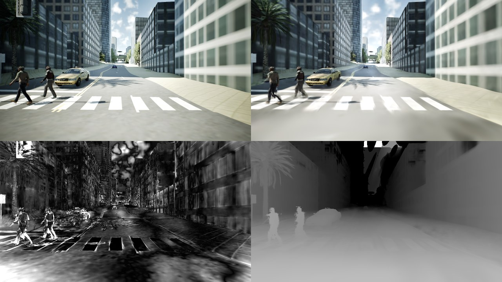

**novel_0160_off+3** (top: CARLA | reconstruction; bottom: |error| x4 | rendered depth)

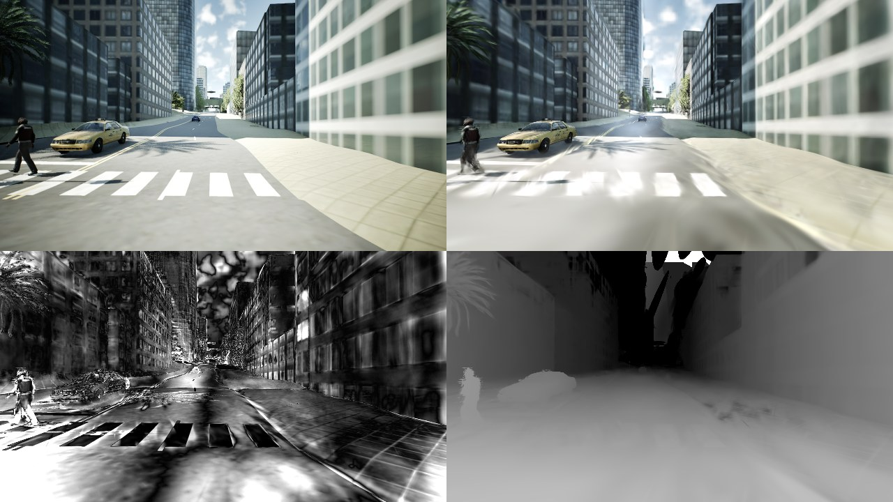

**novel_0160_off-1** (top: CARLA | reconstruction; bottom: |error| x4 | rendered depth)

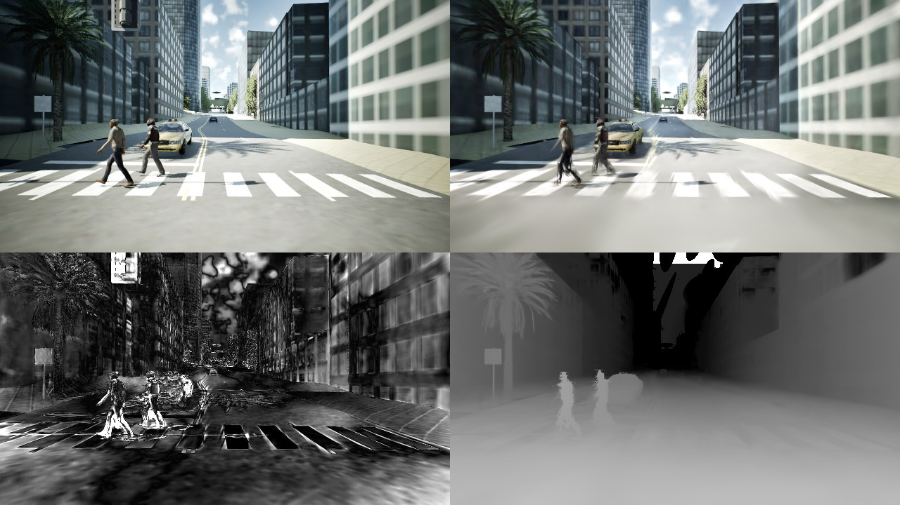

**novel_0160_off-3** (top: CARLA | reconstruction; bottom: |error| x4 | rendered depth)

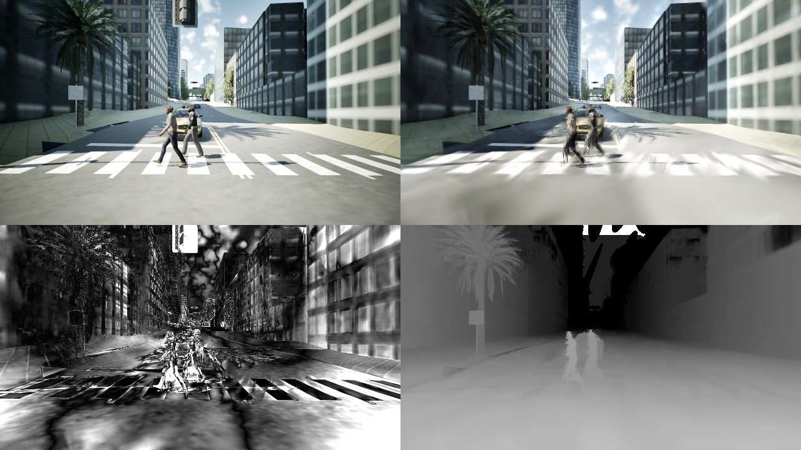

**test_0005_CAM_FRONT** (top: CARLA | reconstruction; bottom: |error| x4 | rendered depth)

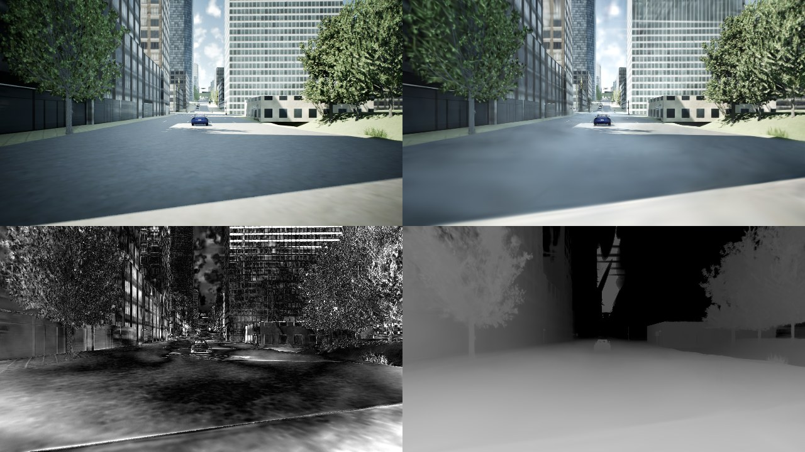

**test_0015_CAM_FRONT** (top: CARLA | reconstruction; bottom: |error| x4 | rendered depth)

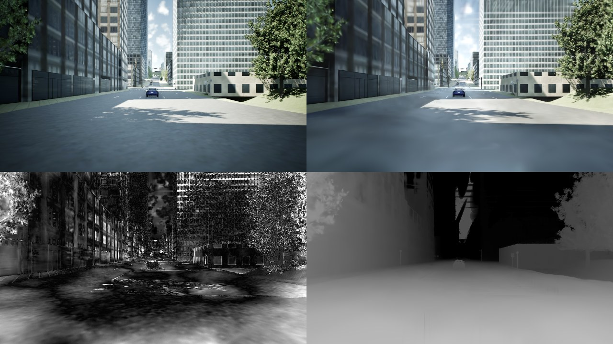

**test_0025_CAM_FRONT** (top: CARLA | reconstruction; bottom: |error| x4 | rendered depth)

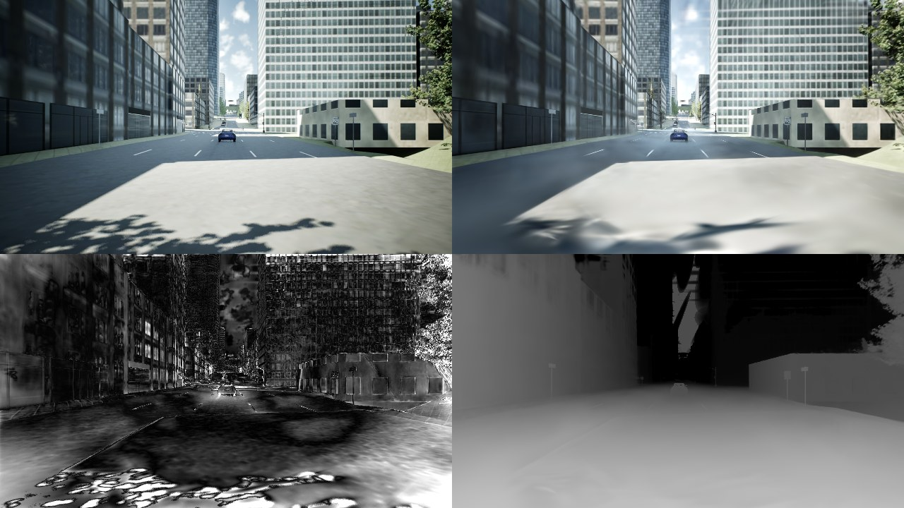

**test_0035_CAM_FRONT** (top: CARLA | reconstruction; bottom: |error| x4 | rendered depth)

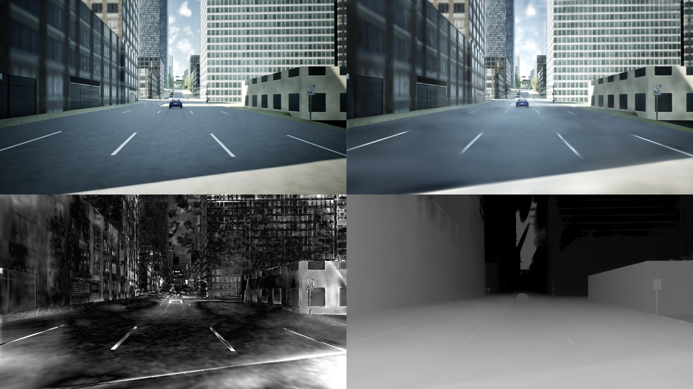

**test_0045_CAM_FRONT** (top: CARLA | reconstruction; bottom: |error| x4 | rendered depth)

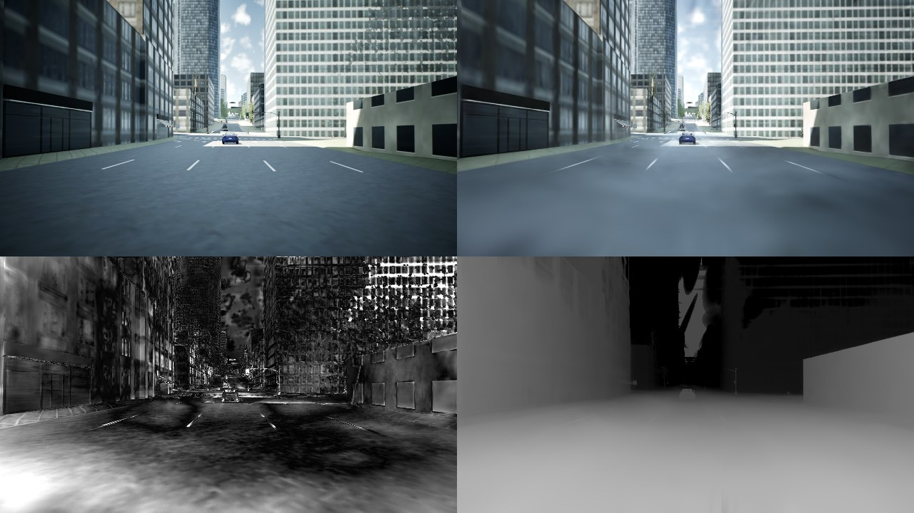

**test_0055_CAM_FRONT** (top: CARLA | reconstruction; bottom: |error| x4 | rendered depth)

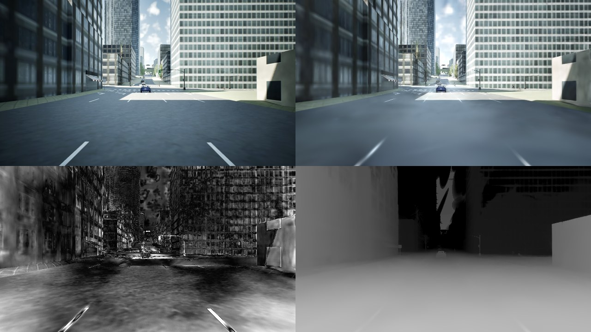
