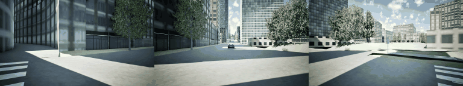
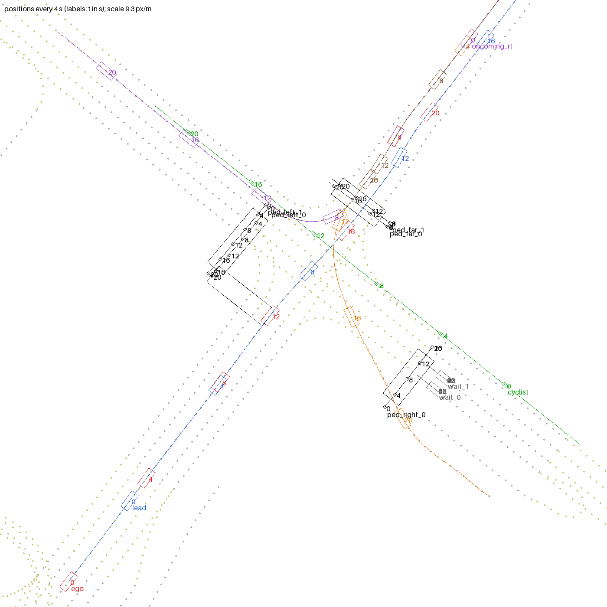
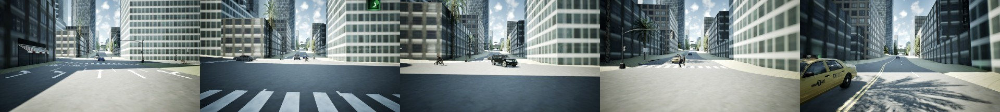

# Scenario: downtown LA, junction 10295 of `LA_DTLA_ODR`

*Front-left, front and front-right cameras of the ego, 20 s at 10 Hz (every 3rd frame).*

Synchronous mode, fixed 0.1 s step, 200 ticks (20 s) after a 30-tick warm-up; weather fixed (sun 55 deg altitude,
200 deg azimuth, 10 % clouds, no wind / rain / fog); the junction's traffic lights frozen (ego road 933 and the
oncoming road 396 green, cross street red). No Traffic Manager and no randomness: vehicles and the cyclist follow
planned paths kinematically, pedestrians walk on CARLA's character physics with a deterministic controller (a second
run reproduces every actor to 0.1 mm).

*Plan (`scenario/plan.py`, CARLA x right, y down): lane centre lines, crosswalks, actor paths and positions every 4 s.*

| actor | class | CARLA blueprint | motion | distance in 20 s |
|---|---|---|---|---|
| ego | car | vehicle.lincoln.mkz | lane -3 of road 933 (left-most straight lane), 8 m/s, slows to 5 m/s for the conflicts, 9 m/s after | 146.5 m |
| lead | car | vehicle.ue4.audi.tt | same lane, 25 m ahead, 9 m/s | 180.0 m |
| oncoming_lt | car | vehicle.nissan.patrol | road 396 towards the ego, **turns left across the ego's path** onto road 787 (in the ego's lane at 13.0 s, ego 18.3 m away) | 134.0 m |
| oncoming_rt | car | vehicle.ue4.chevrolet.impala | road 396 towards the ego, turns right into the cross street | 124.5 m |
| oncoming_stop | car | vehicle.taxi.ford | road 396, stops before the far crosswalk for the pedestrians | 94.0 m |
| cyclist | cyclist | CrossBike mesh (static.prop.mesh) + walker.pedestrian.0015 posed as rider | along the right edge of the 4-lane one-way cross street **through its red light, across the ego's path** at 11.0 s (ego 27.5 m away), 5 m/s | 100.0 m |
| ped_far_0 / ped_far_1 | pedestrian | walker.pedestrian.0016 / 0021 | cross the far crosswalk (road 396) **in front of the ego**, right to left, clear the ego's lane at 15 s | 14.0 / 13.1 m |
| ped_left_0 / ped_left_1 | pedestrian | walker.pedestrian.0026 / 0030 | cross the left crosswalk (parallel to the ego); stop at a building facade the OpenDRIVE crosswalk runs into (see notes) | 11.8 / 12.3 m |
| ped_right_0 | pedestrian | walker.pedestrian.0035 | crosses the right crosswalk | 16.1 m |
| wait_0 / wait_1 | car | vehicle.ue4.mercedes.ccc / ue4.bmw.grantourer | stand at the cross street's red light | 0 |

Closest planned approaches to the ego (footprint gap): oncoming_stop 1.35 m at 17.2 s (passing in the opposite lane),
ped_far_1 2.42 m at 16.7 s, ped_far_0 2.96 m at 16.6 s, oncoming_lt 3.71 m at 14.4 s, cyclist 15.2 m at 13.8 s.

*Front camera at 7.5, 11, 13, 15, 17 s: approach behind the lead car; the cyclist and the left-turning SUV crossing
the ego's path; pedestrians on the far crosswalk; passing the taxi waiting for them.*

## Recorded data (`rec04`)

- 6 cameras x (RGB, depth, instance segmentation) x 201 frames at 1280 x 720 = 3618 images; lidar + semantic lidar
  (64 beams, ~102 k points per sweep) x 201; per frame the pose and 3D box of every actor; CARLA recorder file.
- Novel-view ground truth (`novel04`, re-simulation): the front camera shifted -3, -2, -1, 0, +1, +2, +3 m sideways
  along the driven path, RGB / depth / instance every 4th frame (51 frames x 7 offsets x 3 = 1071 images).
- Wall time on the laptop (RTX 4050 6 GB): recording 224 s + re-simulation 273 s (+ 46 s server start), PNG
  conversion 24 s.
